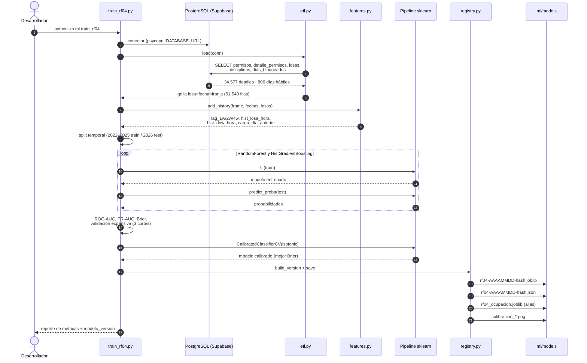

# Diagramas de secuencia — modelo RF-04

Dos diagramas cubren el ciclo completo: entrenamiento offline y consumo desde
la vista del alumno o docente.

Los diagramas están en Mermaid; GitHub, GitLab y VS Code los renderizan sin
instalar nada.

---

## 1. Entrenamiento del modelo (offline)



El reentrenamiento es **manual**: se ejecuta el comando de arriba cuando se
decide actualizar el modelo (recomendado: mensual + inicio de semestre).

---

## 2. Cómo funciona todo (consumo)

Alumno y Docente comparten el mismo acceso: en el frontend ambos tienen
`tipo = "usuario"` (aunque `rol` sea `Alumno` o `Docente`), usan `UserLayout`
y la misma ruta `/predicciones`. Administrador y Seguridad quedan fuera.

| Rol | `tipo` | Acceso a `/predicciones` |
|---|---|---|
| Alumno | `usuario` | Sí |
| Docente | `usuario` | Sí |
| Administrador | `trabajador` | No (dashboard) |
| Seguridad | `trabajador` | No (módulo de garita) |

```mermaid
sequenceDiagram
    autonumber
    actor Job as ml-cron (06:00 Lima)
    participant PRED as predict_ocupacion.py
    participant FS as ml/models
    participant DB as PostgreSQL
    actor A as Alumno
    actor D as Docente
    participant FE as Frontend /predicciones
    participant API as FastAPI

    Note over A,D: Mismo acceso: tipo="usuario"<br/>(rol Alumno o Docente)

    rect rgb(235, 245, 255)
        Note over Job,DB: Fase 1 — predicción batch (06:00)
        Job->>PRED: python -m ml.predict_ocupacion --dias 14
        PRED->>FS: cargar rf04_ocupacion.joblib
        FS-->>PRED: pipeline + features + modelo_version
        PRED->>DB: leer histórico (permisos + detalles)
        PRED->>PRED: próximos 14 días hábiles + predict_proba
        PRED->>DB: DELETE + INSERT prediccion_ocupacion
        Note over DB: fecha, hora, id_l,<br/>probabilidad, modelo_version
        PRED->>DB: purga predicciones con más de 30 días
    end

    rect rgb(240, 250, 240)
        Note over A,API: Fase 2 — consulta del alumno o docente
        A->>FE: iniciar sesión (código)
        FE->>API: POST /api/auth/login/usuario
        API-->>FE: cookies httpOnly (access + refresh)
        Note over FE: UserLayout exige tipo="usuario";<br/>admin y seguridad se redirigen
        D->>FE: mismo login y mismo layout
    end

    rect rgb(255, 248, 235)
        Note over A,API: Fase 3 — vista de predicciones
        A->>FE: abrir /predicciones (fecha por defecto)
        D->>FE: abrir /predicciones
        FE->>API: GET /api/ml/ocupacion?desde&hasta
        API->>API: validar JWT (401 si falta)
        API->>DB: SELECT prediccion_ocupacion<br/>WHERE fecha BETWEEN
        DB-->>API: 840 filas
        API-->>FE: JSON [{fecha, hora, id_l, probabilidad}]
        FE->>FE: filtrar el día y las horas desde la actual
        FE-->>A: grilla por losa/hora (Baja / Media / Alta)
        FE-->>D: grilla por losa/hora (Baja / Media / Alta)
        A->>FE: "Ir a reservar"
        FE-->>A: redirige a /horario
    end
```

---

## Operación del servicio

- `ml-cron` corre dentro de Docker con `restart: unless-stopped`.
- A las 06:00 (America/Lima) verifica si ya hay predicción generada hoy.
- Si Docker estaba apagado y arranca después de las 06:00, la ejecuta al
  iniciar (catch-up).
- Si ya existe la corrida del día, la omite.
- Predice 14 días hábiles (lunes a viernes, sin feriados) y purga lo anterior
  a 30 días.

## Cómo exportarlos

- **GitHub / GitLab:** pegar el bloque en un `.md`; se renderiza solo.
- **VS Code:** extensión *Markdown Preview Mermaid Support*.
- **PDF / informe:** exportar desde [mermaid.live](https://mermaid.live) a PNG
  con escala 2x.

## Recomendación de uso en el informe

| Sección | Diagrama |
|---|---|
| Metodología / modelo | 1. Entrenamiento |
| Arquitectura / funcionamiento | 2. Consumo |
